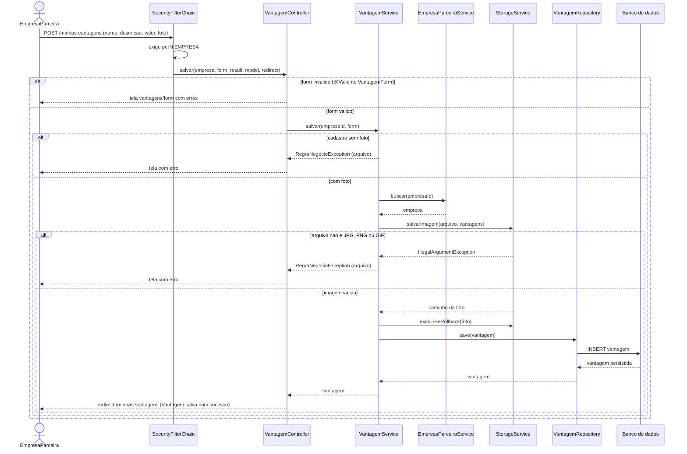
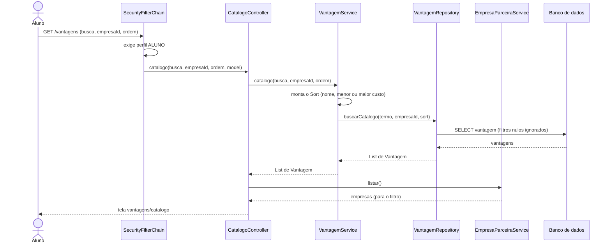

# Diagramas de Sequência: Lab04S02

Casos de uso desta sprint: cadastro de vantagem (empresa parceira) e listagem de vantagens (aluno).
Arquitetura MVC com Spring Boot: SecurityFilterChain, Controller, Service, Repository e banco de dados.

## 1. Cadastro de vantagem (empresa parceira)

## 2. Listagem de vantagens (aluno)

