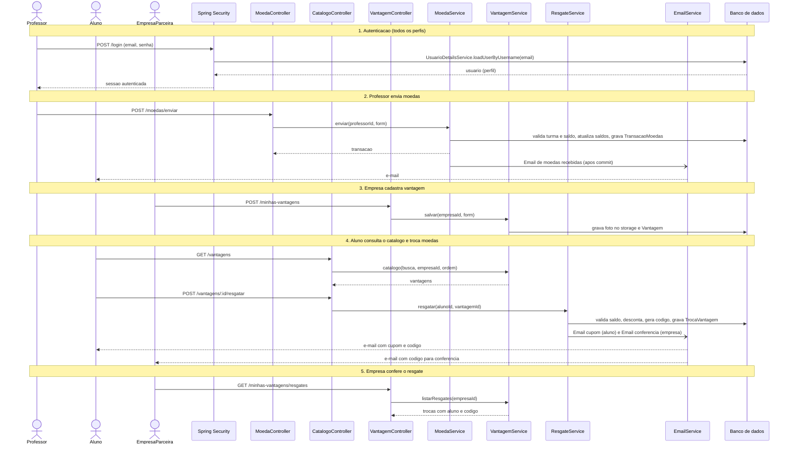
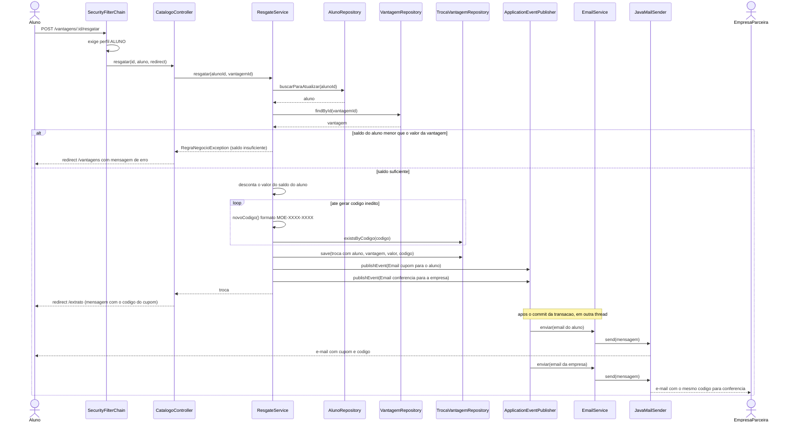

# Diagramas de Sequência: Lab04S03

Caso de uso desta sprint: troca de vantagem pelo aluno, mais o diagrama de sequência geral.
Arquitetura MVC com Spring Boot: SecurityFilterChain, Controller, Service, Repository e banco de dados.

## 1. Diagrama de sequência geral

## 2. Troca de vantagem (aluno)

